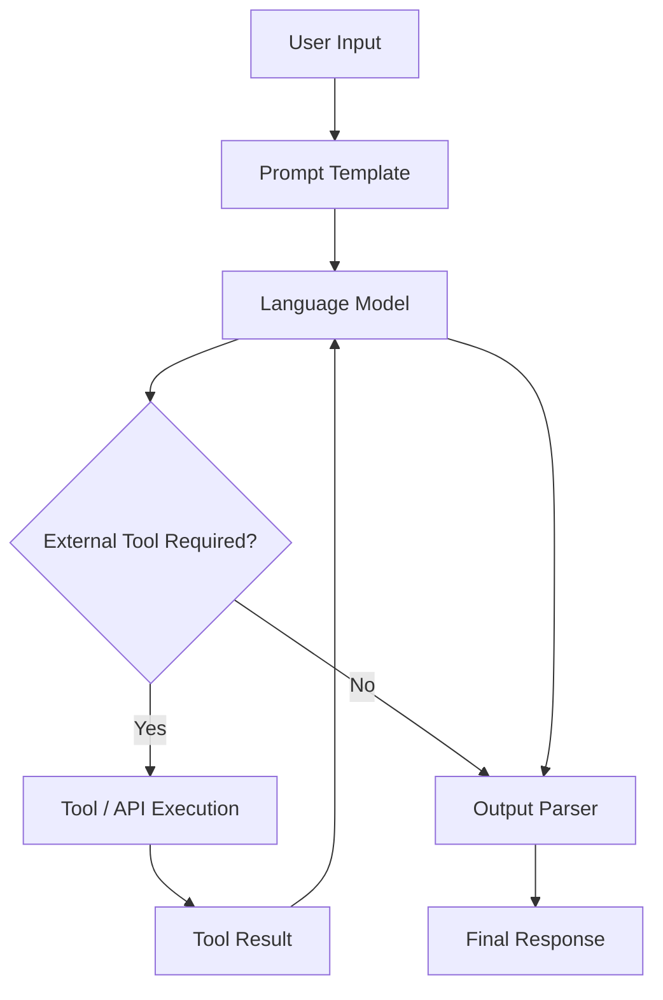
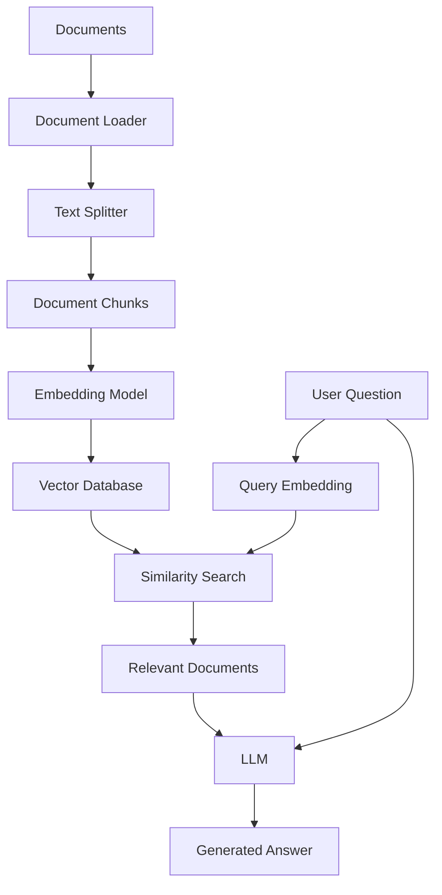
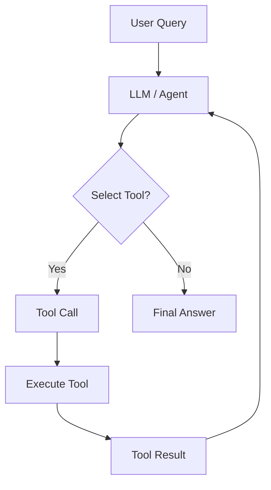

# 🚀 Generative AI & LangChain – Hands-on Learning Repository


A comprehensive hands-on repository documenting my journey of learning and implementing **Generative AI using LangChain**.

This repository contains practical implementations, experiments, code examples, and notes covering Large Language Models (LLMs), Prompt Engineering, Chains, Agents, Tool Calling, Retrieval-Augmented Generation (RAG), Embeddings, Vector Databases, API Integrations, and more.

The primary objective is to understand how LLM-powered applications work internally and learn how to build practical Generative AI applications using modern AI frameworks and tools.

---

## 📌 Table of Contents

- [Overview](#-overview)
- [Learning Objectives](#-learning-objectives)
- [Topics Covered](#-topics-covered)
- [Technologies and Tools](#-technologies-and-tools)
- [Project Structure](#-project-structure)
- [How LangChain Works](#-how-langchain-works)
- [Practical Implementations](#-practical-implementations)
- [Installation and Setup](#-installation-and-setup)
- [Environment Variables](#-environment-variables)
- [Running the Applications](#-running-the-applications)
- [Key Concepts](#-key-concepts)
- [Learning Outcomes](#-learning-outcomes)
- [Future Enhancements](#-future-enhancements)
- [Author](#-author)

---

## 🎯 Overview

Generative AI is transforming how applications understand information, generate content, automate workflows, and interact with users.

LangChain is a framework that helps developers build applications powered by Large Language Models by connecting models with prompts, tools, external APIs, databases, documents, and retrieval systems.

Throughout this repository, I explore the fundamentals of LangChain and gradually move towards building more advanced LLM-powered applications.

The repository focuses on both theoretical understanding and practical implementation.

## 📚 Learning Objectives

- Understand Large Language Models and Generative AI fundamentals.
- Learn how to integrate different LLM providers with LangChain.
- Understand Prompt Templates and structured prompting.
- Build applications using LangChain Expression Language (LCEL).
- Understand Chains, Agents, and Agent Executors.
- Learn Tool Binding and Tool Calling.
- Integrate external APIs with LLM-powered applications.
- Understand document loading, text splitting, and embeddings.
- Implement Retrieval-Augmented Generation (RAG).
- Work with Vector Databases and similarity search.
- Explore conversational memory and chatbot development.
- Understand how to build practical AI applications.

---

## 📖 Topics Covered

### 1. Generative AI and LLM Fundamentals

- Introduction to Generative AI
- Understanding Large Language Models (LLMs)
- How LLMs generate responses
- Different LLM providers
- Model parameters and configurations
- Temperature and token limits
- Open-source and hosted models

### 2. Introduction to LangChain

- What is LangChain?
- LangChain architecture
- Components of LangChain
- Model integrations
- Prompt Templates
- Chat Models
- Output Parsers
- LangChain Expression Language (LCEL)

### 3. Prompt Engineering

- PromptTemplate
- ChatPromptTemplate
- SystemMessage and HumanMessage
- Few-Shot Prompting
- Dynamic Prompt Templates
- Structured Output Generation
- JSON Output Parsing
- Pydantic Output Parsing

### 4. Models and LLM Integrations

Working with different model providers and integrations:

- Groq
- Google Gemini
- Hugging Face
- Ollama
- Chat Model Integrations
- Embedding Model Integrations
- Model Configuration and Invocation

### 5. Chains and LCEL

- Understanding Chains
- Sequential Chains
- RunnableSequence
- RunnableParallel
- RunnablePassthrough
- RunnableLambda
- RunnableBranch
- Chain Composition
- Output Parsing
- LCEL Pipe Operator (`|`)

### 6. Agents and Tool Calling

- Introduction to AI Agents
- Understanding Agent Architecture
- ReAct Agents
- Agent Executors
- Creating Custom Tools
- Built-in LangChain Tools
- Tool Binding
- Tool Calling
- Tool Descriptions and Input Schemas
- InjectedToolArg
- Manual Tool Execution
- Multi-Tool Execution
- Handling Tool Responses
- Agent Output Parsing

### 7. API Integrations

Connecting LLM applications with external services and APIs.

Examples explored:

- Weatherstack API – Weather Information
- ExchangeRate API – Currency Conversion
- DuckDuckGo Search – Web Search
- Wikipedia Integration
- Arxiv Integration
- Custom API-based LangChain Tools

### 8. Retrieval-Augmented Generation (RAG)

Understanding how LLMs retrieve external information before generating answers.

- Introduction to RAG
- RAG Architecture
- Document Loading
- Document Processing
- Text Splitting
- Chunk Size and Chunk Overlap
- Embedding Generation
- Vector Storage
- Similarity Search
- Retriever Creation
- Context Retrieval
- Contextual Question Answering

### 9. Document Loaders and Text Splitters

**Document Loaders:**

- PyPDFLoader
- PyPDFDirectoryLoader
- WebBaseLoader
- YouTube Transcript Loader
- Other LangChain Community Loaders

**Text Splitters:**

- RecursiveCharacterTextSplitter
- CharacterTextSplitter
- Language-based Text Splitting
- Document Chunking
- Overlapping Chunks

### 10. Embeddings and Vector Databases

**Embedding Models:**

- Google Generative AI Embeddings
- Hugging Face Embeddings
- Ollama Embeddings
- Sentence Transformers

**Vector Stores:**

- FAISS
- Chroma
- Astra DB

**Concepts:**

- Text-to-Vector Conversion
- Embedding Dimensions
- Vector Similarity
- Similarity Search
- Metadata Filtering
- Document Retrieval
- Vector Store Persistence

### 11. Advanced Retrievers

- Vector Store Retrievers
- MultiQueryRetriever
- ContextualCompressionRetriever
- LLMChainExtractor
- Document Filtering
- Query Transformation
- Retrieval Optimization

### 12. Chatbots and Conversational AI

- Building LLM-powered Chatbots
- Chat History
- Conversation Context
- Conversational Question Answering
- Streamlit-based Chat Interfaces
- Context-aware Responses

### 13. Monitoring and Observability

- Introduction to LangSmith
- LangChain Tracing
- Execution Monitoring
- Debugging LLM Applications
- Observing Chains and Agents

---

## 🛠️ Technologies and Tools

The following technologies and integrations are explored throughout this repository.

| Category | Technologies / Tools |
|---|---|
| Programming Language | Python |
| AI Framework | LangChain |
| LLM Providers | Groq, Google Gemini, Hugging Face |
| Local LLM Runtime | Ollama |
| Models | GPT-OSS-120B, Llama 3.2, Qwen2.5 and other model experiments |
| Embedding Models | Google Generative AI Embeddings, Hugging Face Embeddings, Ollama Embeddings |
| Vector Databases | FAISS, Chroma, Astra DB |
| Document Processing | PyPDF, LangChain Document Loaders |
| Text Processing | LangChain Text Splitters |
| Web Search | DuckDuckGo Search |
| API Integration | REST APIs, Requests |
| Weather API | Weatherstack |
| Currency API | ExchangeRate API |
| Research Tools | Wikipedia, Arxiv |
| Frontend / UI | Streamlit |
| Backend / API | FastAPI |
| Monitoring | LangSmith |
| Environment Management | Python Virtual Environment, python-dotenv |
| Development Tools | Jupyter Notebook, VS Code |
| Version Control | Git and GitHub |

*Note: The model names represent models explored in the learning process. Availability depends on the selected provider and account configuration.*

---

## 📂 Project Structure

The repository is organized into separate modules to make learning and implementation easier.

```text
Generative AI Using LangChain/
│
├── Agents/
│   ├── Agent implementations
│   ├── ReAct agents
│   ├── Tool binding
│   └── Tool calling
│
├── API/
│   ├── External API integrations
│   └── Custom API tools
│
├── Chains/
│   ├── Chain implementations
│   ├── LCEL
│   └── Runnable components
│
├── Chatbot/
│   └── Conversational AI applications
│
├── groq/
│   └── Groq-powered LLM applications
│
├── RAG/
│   ├── Document loading
│   ├── Text splitting
│   ├── Embeddings
│   ├── Vector databases
│   └── Retrieval implementations
│
├── us_census/
│   └── Document-based RAG experiments
│
├── requirements.txt
├── .env
├── .gitignore
└── README.md
```

---

## 🔄 How LangChain Works

A typical LangChain application connects multiple components to generate an intelligent response.



### RAG Workflow



### Agent and Tool Calling Workflow



---

## 💻 Practical Implementations

This repository includes hands-on experiments and code examples involving the following workflows:

| Implementation | Description |
|---|---|
| LLM Integration | Connecting LangChain with different LLM providers |
| Prompt Engineering | Creating reusable and dynamic prompts |
| Chain Development | Connecting multiple LangChain components |
| ReAct Agents | Building reasoning-and-action workflows |
| Custom Tools | Creating Python functions that LLMs can invoke |
| Tool Binding | Registering tools with language models |
| Tool Calling | Executing tools based on model-generated requests |
| API Integration | Connecting external services with LangChain |
| Document Processing | Loading and splitting documents |
| Embeddings | Converting text into numerical vectors |
| Vector Search | Retrieving relevant documents |
| RAG Applications | Generating answers using external documents |
| Chatbots | Building conversational AI applications |

---

## ⚙️ Installation and Setup

Follow these steps to run the project locally.

### 1. Clone the Repository

```bash
git clone <YOUR_GITHUB_REPOSITORY_URL>
```

### 2. Navigate to the Project Directory

```bash
cd "Generative AI Using LangChain"
```

### 3. Create a Virtual Environment

```bash
python -m venv venv
```

### 4. Activate the Virtual Environment

**Windows:**

```bash
venv\Scripts\activate
```

**Linux / macOS:**

```bash
source venv/bin/activate
```

### 5. Install Dependencies

```bash
python -m pip install -r requirements.txt
```

### 6. Configure Environment Variables

Create a `.env` file in the root directory and add the API keys required by the modules you want to run.

---

## 🔐 Environment Variables

The following environment variables are used across the different integrations. Configure only the credentials required by the application you are running.

```env
# Groq
GROQ_API_KEY=your_groq_api_key

# Google Gemini
GOOGLE_API_KEY=your_google_api_key

# Hugging Face
HF_TOKEN=your_huggingface_token

# LangSmith
LANGCHAIN_API_KEY=your_langsmith_api_key
LANGCHAIN_TRACING_V2=true
LANGCHAIN_PROJECT=your_project_name

# Weatherstack
WEATHERSTACK_API_KEY=your_weatherstack_api_key
```

Load the environment variables using:

```python
from dotenv import load_dotenv
import os

load_dotenv()

groq_api_key = os.getenv("GROQ_API_KEY")
google_api_key = os.getenv("GOOGLE_API_KEY")
hf_token = os.getenv("HF_TOKEN")
```

**Security Note:**

- Never upload your `.env` file to GitHub.
- Add `.env` to `.gitignore`.
- Never expose API keys in source code or screenshots.
- Use environment variables to manage credentials securely.

---

## ▶️ Running the Applications

Run the relevant notebook or Python application depending on the module you want to explore.

### Start Jupyter Notebook

```bash
jupyter notebook
```

### Run a Streamlit Application

For the Groq application, if the corresponding script is present:

```bash
streamlit run groq/llamma3.py
```

### Run a FastAPI Application

For a FastAPI module, use:

```bash
uvicorn main:app --reload
```

Make sure you execute the command from the directory containing the relevant `main.py` file.

### Run Ollama Models Locally

Install Ollama and pull a model:

```bash
ollama pull llama3.2
```

Run the model:

```bash
ollama run llama3.2
```

Check installed models:

```bash
ollama list
```

For local embeddings, an example model is:

```bash
ollama pull nomic-embed-text
```

---

## 🧠 Key Concepts Learned

| Concept | Understanding |
|---|---|
| LLM | A language model capable of understanding and generating text |
| Prompt Template | A reusable structure for providing instructions to an LLM |
| Chain | A sequence of connected processing components |
| Agent | An LLM-powered system that decides which actions or tools to use |
| Tool Binding | Registering available tools, descriptions, and schemas with an LLM |
| Tool Calling | The model requesting execution of a particular tool with arguments |
| ReAct | Reasoning and acting through a Thought–Action–Observation workflow |
| Embeddings | Numerical representations of text |
| Vector Database | A system for storing and searching vector representations |
| Retriever | A component that fetches relevant documents |
| RAG | Combining document retrieval with LLM-generated answers |
| LCEL | LangChain Expression Language for composing runnable components |

---

## 🎓 Learning Outcomes

Through this hands-on learning journey, I am developing practical skills in:

- Working with different LLM providers.
- Designing prompts and structured LLM workflows.
- Building modular applications using LangChain.
- Creating custom tools and integrating external APIs.
- Understanding agent-based AI workflows.
- Implementing document-based retrieval systems.
- Working with embedding models and vector databases.
- Building conversational AI applications.
- Debugging and monitoring LLM applications.
- Understanding the architecture behind Generative AI applications.

---

## 🚀 Future Enhancements

- Explore advanced Agentic AI architectures.
- Build more advanced multi-tool agents.
- Implement advanced RAG techniques.
- Explore hybrid search and reranking.
- Develop production-ready AI applications.
- Integrate additional LLM providers and APIs.
- Explore LangGraph for stateful agent workflows.
- Improve LLM evaluation and observability.

---

## 👨‍💻 Author

**Satwik Reddy K**

B.Tech – Computer Science and Engineering

GitHub: [@Satwik-2005](https://github.com/Satwik-2005)

LinkedIn: [Connect with me](https://www.linkedin.com/)

---

⭐ If you find this repository useful, consider giving it a star!

**Learning, experimenting, building, and exploring the world of Generative AI — one implementation at a time.**